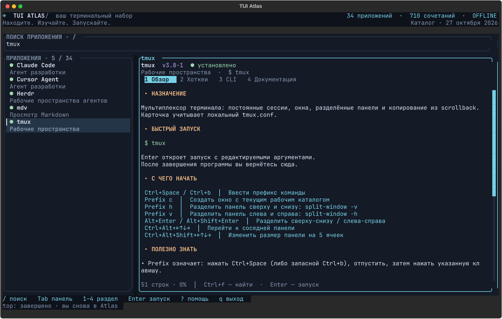

# TUI Atlas

Каталог 37 терминальных приложений на этой машине: описание, 874 горячих клавиш, 284 примеров команд и запуск из одного окна. Интерфейс на русском, с управлением клавиатурой и мышью.



```sh
tui-atlas
```

## Управление

| Клавиша | Действие |
|---|---|
| `/` | Найти приложение по названию, категории, команде или действию |
| `j/k`, `↑/↓` | Выбрать приложение или прокрутить текст в активной панели |
| `Tab`, `h/l`, `←/→` | Сменить активную панель |
| `1` / `2` / `3` / `4` | Обзор / хоткеи / CLI / документация |
| `[` / `]` | Предыдущий / следующий раздел |
| `PgUp/PgDn`, `gg/G` | Страница вверх/вниз, начало/конец |
| `Ctrl+f`, затем `n/N` | Поиск внутри текста, следующее/предыдущее совпадение |
| `Enter`, `e` | Открыть запуск с редактируемыми аргументами |
| `Ctrl+u` при вводе | Очистить строку |
| `Esc` | Закончить ввод; повторное нажатие очищает поиск |
| `r` | Перечитать справку и проверить наличие выбранной программы |
| `?`, `F1` | Подсказка |
| `q`, `Ctrl+c` | Выход; при вводе `Ctrl+c` отменяет ввод |

Колесо прокручивает панель под указателем. Клик выбирает приложение, раздел или активную панель. В узком терминале видна одна панель: переключайте её через `Tab`.

Переменная `NO_COLOR` отключает цвета. Для цветного интерфейса при установленной переменной: `env -u NO_COLOR tui-atlas`.

## Запуск приложений

Нажмите `Enter`, проверьте аргументы, затем ещё раз `Enter`. После выхода из дочернего приложения Atlas восстановится. `Ctrl+c` передаётся дочерней программе.

Кавычки объединяют слова: `"файл с пробелами.md"` — один аргумент. Shell не используется: `$HOME`, `~`, `*`, `|` и `;` передаются буквально. Указывайте абсолютный путь или путь относительно каталога, из которого запущен Atlas. Команды из примеров можно использовать как подсказки; окно запуска принимает только аргументы выбранной программы.

Просмотрщики `less`, `more`, `presenterm` требуют файл в аргументах. Для `cfdisk` по умолчанию задан `--read-only`, для K9s — `--readonly`; аргументы доступны для редактирования. Запуск `tmux` внутри уже открытого tmux может быть отклонён самим tmux. Внешние процессы используют `work-run`, когда он доступен в PATH.

## Откуда берётся справка

Встроенный каталог — снимок инвентаризации от **27 октября 2026 года**. Версии в заголовках относятся к этому снимку; наличие исполняемого файла проверяется при старте и по `r`. Карточка Forge Deck 0.3.0 добавлена 28 октября 2026 года. Автоматической установки или обновления приложений нет.

- **Обзор и хоткеи:** проверенные карточки с указанием первичных источников. Найденные пользовательские переназначения отмечены отдельно.
- **CLI:** примеры и оригинальный вывод безопасной команды получения справки установленной программы.
- **Документация:** доступные локальные man-страницы, файлы документации и известные файлы настроек. Адреса официальных сайтов показаны как ссылки-источники; сеть для чтения не используется.

Справка загружается фоновым потоком, ограничена по времени и объёму; ошибки и обрезание отображаются в тексте. Терминальные управляющие последовательности удаляются. Для Yazi, чей `--help` требует терминал, этот вызов отключён.

Читшиты покрывают базовые команды и обнаруженные настройки. Список всех динамических команд и хоткеев плагинов Neovim, а также онлайн-документация целиком в каталог не включены. Для расширения карточки редактируйте соответствующий `data/guides-*.json` и пересоберите приложение. Контракт: [docs/data-contract.md](docs/data-contract.md).

## Сборка и установка

Нужны Linux и Rust с поддержкой edition 2024. Команды для этой машины:

```sh
work-run -- cargo test
work-run -- cargo fmt --check
work-run -- cargo clippy --all-targets -- -D warnings
work-run -- cargo build --release
work-run -- install -m 755 target/release/tui-atlas ~/.local/bin/tui-atlas
```

Исходники не зависят от `work-run` при его отсутствии. `Cargo.lock` фиксирует зависимости. Каталог и карточки встроены в исполняемый файл, поэтому для запуска не нужен текущий каталог проекта.

Результаты тестов и проверки терминала: [docs/verification.md](docs/verification.md).
