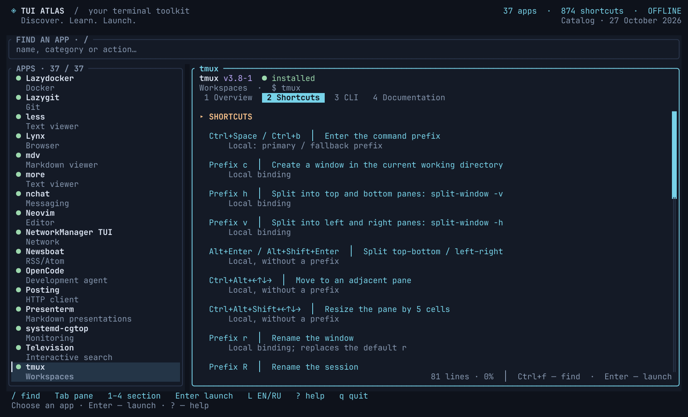

<div align="center">

# TUI Atlas

**English** · [Русский](README.ru.md)

### Discover. Learn. Launch.

37 terminal apps · 874 shortcuts · 284 command examples

[](https://github.com/IgorKramar/tui-atlas/actions/workflows/ci.yml)
[](https://github.com/IgorKramar/tui-atlas/releases/latest)
[](LICENSE)


[Install](#install) · [Explore](#explore) · [Language](#language) · [Keys](#keys) · [Catalog](#where-the-help-comes-from)

</div>


**A home for the terminal tools you keep forgetting the keys to.**
TUI Atlas brings a curated app catalog, searchable cheatsheets, CLI examples, local documentation, and a launcher into one Rust TUI. Browse in English or Russian; search in either language.

Rounded panels, a quiet dark palette, clear focus, keyboard navigation, and mouse support. Everything you need to browse the built-in cards is embedded in the binary.

## Explore

```sh
tui-atlas
```

1. Press `/` and search for an app, category, command, or action.
2. Use `1`–`4` to open **Overview**, **Shortcuts**, **CLI**, or **Documentation**.
3. Press `Enter` to inspect launch arguments, then `Enter` again to run the selected app.
4. Exit the child app to return to Atlas.



**37 cards:** editors, file managers, Git and forge clients, containers, Kubernetes, system monitors, disk tools, chat, mail, feeds, browsers, API tools, media, launchers, and terminal utilities. Apps do not need to be installed to read their built-in cards.

## Install

### Prebuilt Linux binary

Download from [Releases](https://github.com/IgorKramar/tui-atlas/releases/latest). Archives are available for **x86_64** and **ARM64**, built on Ubuntu 22.04 with glibc. They are not musl/Alpine binaries. Rust is not needed to run them.

```sh
version=0.2.0
target=x86_64-unknown-linux-gnu  # ARM64: aarch64-unknown-linux-gnu
archive="tui-atlas-v$version-$target.tar.gz"
base="https://github.com/IgorKramar/tui-atlas/releases/download/v$version"
curl --fail --location --remote-name "$base/$archive" --remote-name "$base/SHA256SUMS" &&
awk -v archive="$archive" '$2 == archive' SHA256SUMS | sha256sum --check - &&
tar -xzf "$archive" &&
install -Dm755 "tui-atlas-v$version-$target/tui-atlas" "$HOME/.local/bin/tui-atlas"
```

Keep `~/.local/bin` in your `PATH`. The archive also includes both READMEs, the license, changelog, screenshots, data contract, and `BUILDINFO.json` with the source commit and target.

### Build with Cargo

You need Linux, Git, and a current stable Rust toolchain supporting edition 2024.

```sh
cargo install --git https://github.com/IgorKramar/tui-atlas --tag v0.2.0 --locked
```

Cargo normally installs to `~/.cargo/bin`; keep it in `PATH`. The catalog is compiled into the executable, so running from the project directory is unnecessary. Third-party apps are installed separately.

Use a terminal with Unicode support and, for icons, a [Nerd Font](https://www.nerdfonts.com/). Minimum usable size: **36 × 12**; a wider window shows both panes. Set `NO_COLOR` to disable colors; `env -u NO_COLOR tui-atlas` restores them.

## Language

```sh
tui-atlas --lang en
tui-atlas --lang ru
```

Press **`L`** outside text input to switch EN/RU without losing your selected card or tab. The selected language is saved on normal startup and when switched:

```text
$XDG_CONFIG_HOME/tui-atlas/config.json
# or ~/.config/tui-atlas/config.json
```

Priority: `--lang` → saved language → system locale → English. The first non-empty `LC_ALL`, `LC_MESSAGES`, or `LANG` is used: `ru` selects Russian; other locales select English. `--help` uses `--lang` or the locale and does not read or write preferences.

The interface and curated catalog are translated, including shortcut explanations and example descriptions. Search indexes both languages. Command names, flags, executable paths, and source links keep their meaning. Output from installed programs, man pages, and local files stays in its original language.

## Keys

| Keys | Action |
|:---|:---|
| `/` | Search apps, categories, commands, and actions |
| `j` / `k`, `↑` / `↓` | Select an app or scroll the focused pane |
| `Tab`, `h` / `l`, `←` / `→` | Switch pane |
| `1` / `2` / `3` / `4` | Overview / shortcuts / CLI / documentation |
| `[` / `]` | Previous / next tab |
| `PgUp` / `PgDn`, `gg` / `G` | Page up/down, start/end |
| `Ctrl+f`, then `n` / `N` | Find in text; next/previous match |
| `Enter`, `e` | Open editable launch arguments |
| `Ctrl+u` while typing | Clear the input |
| `Esc` | Finish input; press again to clear search |
| `r` | Reload help and recheck the selected executable |
| `L` | Switch and save EN/RU outside text input |
| `?`, `F1` | Help |
| `q`, `Ctrl+c` | Quit; `Ctrl+c` cancels active input first |

Click to select a card, tab, or pane. The mouse wheel scrolls the pane under the pointer. Narrow windows show one pane at a time; use `Tab` to switch.

## Launching apps

Atlas pauses its UI while the child app runs and restores it afterward. `Ctrl+c` is delivered to the child.

Quotes group words: `"a file with spaces.md"` is one argument. **No shell expansion:** `$HOME`, `~`, `*`, `|`, and `;` are literal arguments. Use absolute paths or paths relative to the directory where you started Atlas. The launch dialog accepts arguments for the selected program, not a complete shell command.

Viewers such as `less`, `more`, and `presenterm` need a file argument. `cfdisk` defaults to `--read-only`, and K9s to `--readonly`; these arguments remain editable. Running tmux inside tmux may be rejected by tmux itself. External commands use `work-run` if available in `PATH`; it is optional.

## Where the help comes from

The built-in catalog is a **27 October 2026 snapshot**, with the Forge Deck 0.3.0 card added on 28 October. Version labels describe that snapshot, not a live inventory of your machine. Executable availability is checked at startup and with `r`; Atlas does not install or update other apps.

| Tab | Source |
|:---|:---|
| Overview & shortcuts | Curated cards with primary-source references and marked local bindings |
| CLI | Embedded examples plus a bounded help command from the installed program |
| Documentation | Available local man pages, documentation files, and known keybinding configs; official links are displayed as references |

Help loads in the background with time and output limits. Failures and truncation are shown; terminal control sequences are removed. No online documentation is fetched. Yazi's help invocation is disabled because it needs a terminal.

The catalog reflects a Linux setup, including known executable paths and some local keybindings. Those bindings are marked; they are not automatically derived from your config. On another installation, adjust `data/inventory.json` paths and the relevant guide before rebuilding. Missing executables do not prevent card browsing. Neovim plugin mappings and complete online manuals are outside the curated catalog.

To add or update cards and translations, see the [data contract](docs/data-contract.md).

## Development and releases

```sh
git clone https://github.com/IgorKramar/tui-atlas.git
cd tui-atlas
cargo fmt --all -- --check
cargo clippy --locked --all-targets -- -D warnings
cargo test --locked
cargo build --release --locked
python3 tests/terminal_smoke.py target/release/tui-atlas
python3 -m unittest discover -s tests -p test_release.py
```

CI checks formatting, Clippy, Rust tests, packaging, and the extracted executable on native Linux x86_64 and ARM64 runners. PTY smoke checks cover both languages, wide/narrow/tiny terminals, switching language, launching a harmless fixture, returning to Atlas, and terminal restoration.

Pushing a `v*` tag runs the same checks, verifies that the tag matches the Cargo version, and publishes two archives plus `SHA256SUMS`. Release notes live in `docs/releases/`; see the [changelog](CHANGELOG.md). Each archive contains only an explicit list of public files.

[Open an issue](https://github.com/IgorKramar/tui-atlas/issues) with your app version, terminal size, and reproduction steps. For a pull request, describe the behavior change, update both languages, and run the checks above. Never include credentials or private configuration.

## License

[MIT](LICENSE) · Copyright © 2026 [Igor Kramar](https://github.com/IgorKramar).
