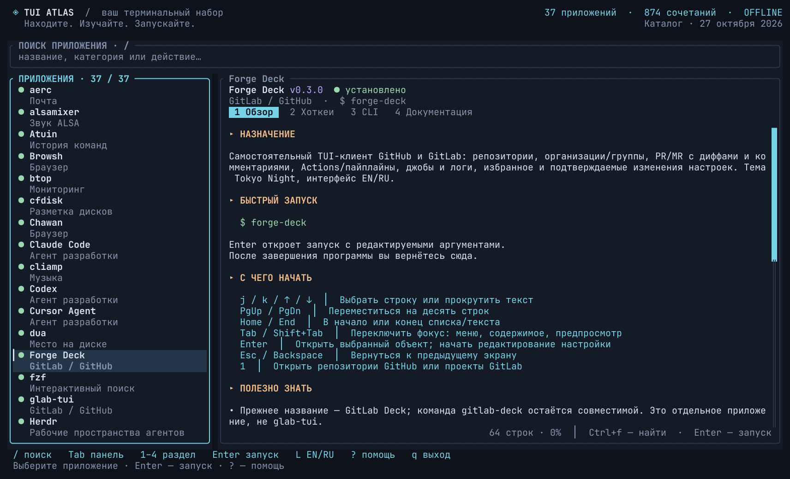
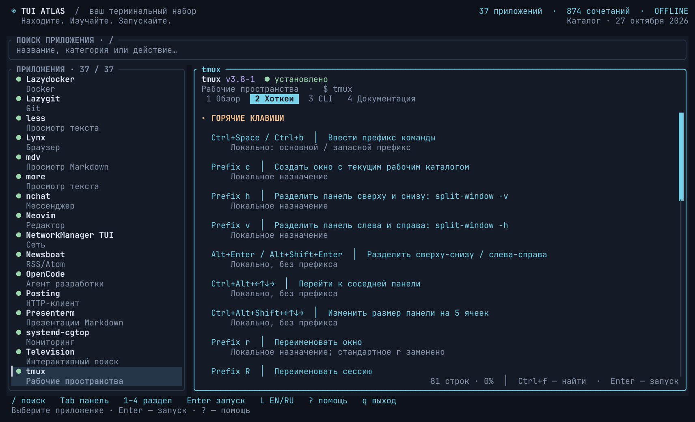

<div align="center">

# TUI Atlas

[English](README.md) · **Русский**

### Находите. Изучайте. Запускайте.

37 терминальных приложений · 874 сочетания клавиш · 284 примера команд

[](https://github.com/IgorKramar/tui-atlas/actions/workflows/ci.yml)
[](https://github.com/IgorKramar/tui-atlas/releases/latest)
[](LICENSE)


[Установка](#установка) · [Знакомство](#знакомство) · [Язык](#язык) · [Клавиши](#клавиши) · [Каталог](#откуда-берётся-справка)

</div>



**Все терминальные инструменты, чьи клавиши постоянно забываются, — в одном месте.**
TUI Atlas объединяет каталог приложений, читшиты с поиском, примеры CLI, локальную документацию и запуск в одном TUI на Rust. Интерфейс и карточки — на русском и английском; поиск работает на обоих языках.

Скруглённые панели, спокойная тёмная палитра, заметный фокус, клавиатура и мышь. Встроенные карточки доступны сразу из исполняемого файла.

## Знакомство

```sh
tui-atlas
```

1. Нажмите `/` и найдите приложение, категорию, команду или действие.
2. Клавишами `1`–`4` откройте **Обзор**, **Хоткеи**, **CLI** или **Документацию**.
3. Нажмите `Enter`, проверьте аргументы и ещё раз `Enter`, чтобы запустить приложение.
4. Выйдите из дочернего приложения, чтобы вернуться в Atlas.



**37 карточек:** редакторы, файловые менеджеры, Git и forge-клиенты, контейнеры, Kubernetes, мониторы системы, дисковые утилиты, чаты, почта, RSS, браузеры, API-инструменты, медиа, поиск и терминальные утилиты. Для чтения встроенной карточки устанавливать саму программу не обязательно.

## Установка

### Готовый бинарник для Linux

Архивы для **x86_64** и **ARM64** доступны в [Releases](https://github.com/IgorKramar/tui-atlas/releases/latest). Они собираются на Ubuntu 22.04 с glibc и не предназначены для musl/Alpine. Для запуска Rust не нужен.

```sh
version=0.2.0
target=x86_64-unknown-linux-gnu  # ARM64: aarch64-unknown-linux-gnu
archive="tui-atlas-v$version-$target.tar.gz"
base="https://github.com/IgorKramar/tui-atlas/releases/download/v$version"
curl --fail --location --remote-name "$base/$archive" --remote-name "$base/SHA256SUMS" &&
awk -v archive="$archive" '$2 == archive' SHA256SUMS | sha256sum --check - &&
tar -xzf "$archive" &&
install -Dm755 "tui-atlas-v$version-$target/tui-atlas" "$HOME/.local/bin/tui-atlas"
```

Добавьте `~/.local/bin` в `PATH`. В архив также входят оба README, лицензия, changelog, скриншоты, контракт данных и `BUILDINFO.json` с коммитом исходников и целевой платформой.

### Сборка через Cargo

Нужны Linux, Git и актуальный стабильный Rust с поддержкой edition 2024.

```sh
cargo install --git https://github.com/IgorKramar/tui-atlas --tag v0.2.0 --locked
```

Cargo обычно устанавливает программы в `~/.cargo/bin`; добавьте этот каталог в `PATH`. Каталог встроен в исполняемый файл, запускать Atlas из каталога проекта не нужно. Сторонние приложения устанавливаются отдельно.

Используйте терминал с Unicode и [Nerd Font](https://www.nerdfonts.com/) для иконок. Минимальный рабочий размер — **36 × 12**; в широком окне видны обе панели. `NO_COLOR` отключает цвета; `env -u NO_COLOR tui-atlas` возвращает их.

## Язык

```sh
tui-atlas --lang en
tui-atlas --lang ru
```

**`L`** вне ввода текста переключает EN/RU, сохраняя выбранную карточку и раздел. Язык записывается при обычном запуске и при переключении:

```text
$XDG_CONFIG_HOME/tui-atlas/config.json
# или ~/.config/tui-atlas/config.json
```

Приоритет: `--lang` → сохранённый язык → системная локаль → английский. Используется первое непустое значение `LC_ALL`, `LC_MESSAGES` или `LANG`: `ru` выбирает русский, остальные — английский. `--help` использует `--lang` или локаль, не читая и не записывая настройки.

Переведены интерфейс и встроенный каталог, включая объяснения сочетаний и описания примеров. Поиск учитывает оба языка. Имена команд, флаги, пути к программам и ссылки на источники сохраняют свой смысл. Вывод установленных программ, man-страницы и локальные файлы остаются на исходном языке.

## Клавиши

| Клавиши | Действие |
|:---|:---|
| `/` | Найти приложение, категорию, команду или действие |
| `j` / `k`, `↑` / `↓` | Выбрать приложение или прокрутить активную панель |
| `Tab`, `h` / `l`, `←` / `→` | Переключить панель |
| `1` / `2` / `3` / `4` | Обзор / хоткеи / CLI / документация |
| `[` / `]` | Предыдущий / следующий раздел |
| `PgUp` / `PgDn`, `gg` / `G` | Страница вверх/вниз, начало/конец |
| `Ctrl+f`, затем `n` / `N` | Поиск в тексте, следующее/предыдущее совпадение |
| `Enter`, `e` | Открыть редактируемые аргументы запуска |
| `Ctrl+u` при вводе | Очистить строку |
| `Esc` | Закончить ввод; повторное нажатие очищает поиск |
| `r` | Перечитать справку и проверить наличие выбранной программы |
| `L` | Переключить и сохранить EN/RU вне ввода текста |
| `?`, `F1` | Подсказка |
| `q`, `Ctrl+c` | Выход; при вводе `Ctrl+c` сначала отменяет ввод |

Клик выбирает приложение, раздел или панель. Колесо прокручивает панель под указателем. В узком терминале видна одна панель; переключайте её через `Tab`.

## Запуск приложений

Atlas приостанавливает свой интерфейс на время работы дочерней программы и восстанавливается после её завершения. `Ctrl+c` передаётся дочернему процессу.

Кавычки объединяют слова: `"файл с пробелами.md"` — один аргумент. **Shell не используется:** `$HOME`, `~`, `*`, `|` и `;` передаются буквально. Указывайте абсолютные пути или пути относительно каталога, из которого запущен Atlas. Окно запуска принимает аргументы выбранной программы, а не полную команду shell.

Просмотрщикам `less`, `more`, `presenterm` нужен файл в аргументах. Для `cfdisk` по умолчанию задан `--read-only`, для K9s — `--readonly`; аргументы можно менять. Запуск tmux внутри tmux может быть отклонён самим tmux. Внешние команды используют `work-run`, если он доступен в `PATH`; обязательной зависимости от него нет.

## Откуда берётся справка

Встроенный каталог — **снимок от 27 октября 2026 года**; карточка Forge Deck 0.3.0 добавлена 28 октября. Версии относятся к этому снимку, а не к текущему набору программ на вашем компьютере. Наличие исполняемого файла проверяется при старте и по `r`; Atlas не устанавливает и не обновляет приложения.

| Раздел | Источник |
|:---|:---|
| Обзор и хоткеи | Проверенные карточки со ссылками на первичные источники и отмеченными локальными назначениями |
| CLI | Встроенные примеры и ограниченный по времени и объёму вызов справки установленной программы |
| Документация | Доступные локальные man-страницы, документация и известные файлы сочетаний; официальные ссылки показаны как источники |

Справка загружается в фоне. Ошибки и обрезание отображаются, управляющие последовательности терминала удаляются. Онлайн-документация не скачивается. Вызов справки Yazi отключён, поскольку ему нужен терминал.

Каталог отражает определённую Linux-систему, включая известные пути к исполняемым файлам и часть локальных сочетаний. Такие сочетания отмечены; автоматически из вашего конфига они не извлекаются. В другой системе может потребоваться изменить пути в `data/inventory.json` и соответствующие карточки, затем пересобрать Atlas. Отсутствие программы не мешает чтению карточки. Динамические назначения плагинов Neovim и полные онлайн-руководства в каталог не входят.

Добавление карточек и переводов описано в [контракте данных](docs/data-contract.ru.md).

## Разработка и релизы

```sh
git clone https://github.com/IgorKramar/tui-atlas.git
cd tui-atlas
cargo fmt --all -- --check
cargo clippy --locked --all-targets -- -D warnings
cargo test --locked
cargo build --release --locked
python3 tests/terminal_smoke.py target/release/tui-atlas
python3 -m unittest discover -s tests -p test_release.py
```

CI проверяет форматирование, Clippy, Rust-тесты, упаковку и извлечённый бинарник на нативных Linux-раннерах x86_64 и ARM64. PTY-проверки охватывают оба языка, широкий, узкий и слишком маленький терминал, переключение языка, запуск безвредной подставной программы, возврат в Atlas и восстановление терминала.

Пуш тега `v*` запускает те же проверки, сверяет тег с версией Cargo и публикует два архива вместе с `SHA256SUMS`. Описание релиза хранится в `docs/releases/`; изменения — в [changelog](CHANGELOG.md). В архив попадает только явный список публичных файлов.

При сбое публикации черновик остаётся для проверки. Изучите неудачный прогон и его черновик, удалите только этот неудачный черновик, сохранив Git-тег, затем повторите workflow; опубликованные релизы автоматически не перезаписываются.

[Создайте issue](https://github.com/IgorKramar/tui-atlas/issues), указав версию, размер терминала и шаги воспроизведения. Для pull request опишите изменение поведения, обновите оба языка и выполните проверки выше. Не прикладывайте доступы и приватные настройки.

## Лицензия

[MIT](LICENSE) · Copyright © 2026 [Igor Kramar](https://github.com/IgorKramar).
